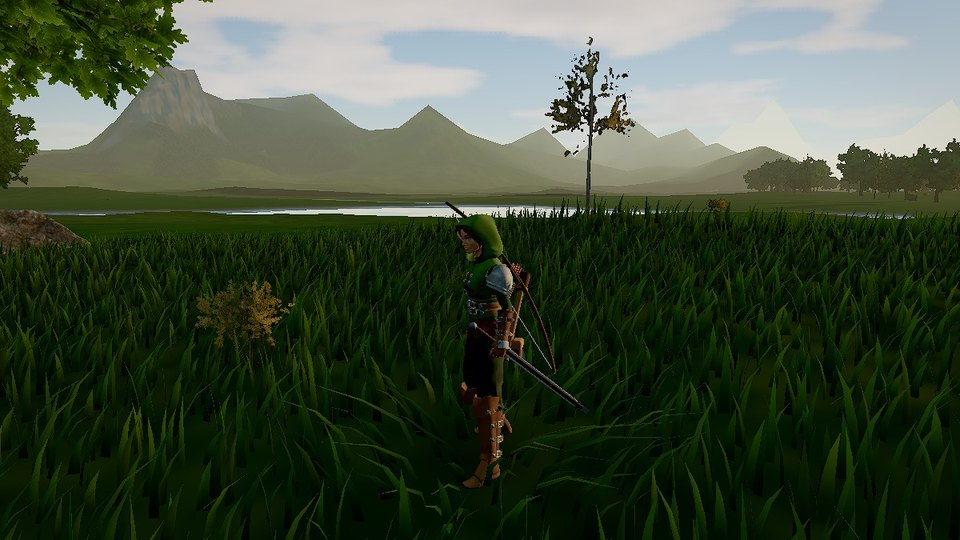
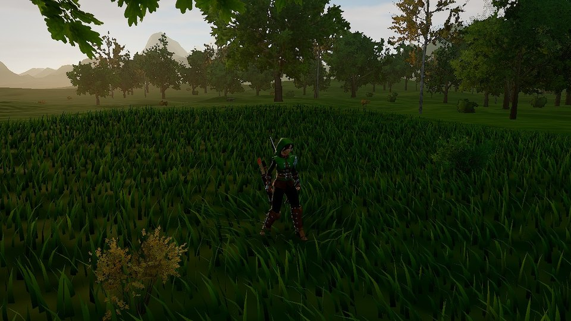

<p align="center">
  
</p>

<h1 align="center">Generate Infinite</h1>

<p align="center">
  <b>An endless world, generated as you walk.</b><br>
  Hills, forests, lakes and mountains under a real sky, with a ranger or a villager to explore them. In your browser, nothing to install.
</p>

<p align="center">
  <a href="https://generate-infinite.vercel.app"><b>▶ Play now</b></a> ·
  <a href="docs/FEATURES.md">Everything in it</a> ·
  <a href="#controls">Controls</a> ·
  <a href="#run-it-yourself">Run it yourself</a>
</p>

<p align="center">
  
</p>

## A world without an edge

Every step reveals land nobody has seen before. The ground is shaped as you travel: lowland plains, rolling hills, ridged mountain ranges and lakes in the basins. Forests grow where the land suits them, and the sky moves through a full day and night. Walk in any direction and it never runs out. Give the address a seed (`?seed=anything`) and you get a different world, the same one every time.

<table>
  <tr>
    <td width="50%"></td>
    <td width="50%"></td>
  </tr>
  <tr>
    <td width="50%"></td>
    <td width="50%"></td>
  </tr>
</table>

## What you can do

- **Explore on foot.** Walk, jog and sprint with a runner's weight, then climb rock faces one hold at a time, swim and dive in the lakes, slide down slopes.
- **Live off the land.** The Ranger carries a sword, a bow and a torch; the Villager an axe, a hoe and a sickle. Each is worn the way people carried them and drawn step by step.
- **Fell a tree.** Only the axe does it: notches bite where you strike, and the trunk falls toward the cut, leaving a stump and a log you can climb over.
- **Shoot the bow like an archer.** Stand side-on, take an arrow from the quiver, draw to the cheek. Arrows fly with gravity and stick where they land.
- **Watch the sky.** A physically based sky gives orange sunsets, deep blue dusk and moonlit nights. Clouds drift with the wind and rain rolls in.
- **Listen.** Every sound is made as you play: wind, rain, birdsong by day, crickets at night, footsteps, splashes, the twang of the bow.

## Built for the browser

- **Three.js and TypeScript**, rendered in linear HDR with ambient occlusion, bloom, filmic tone mapping and temporal anti-aliasing.
- **Cascaded sun shadows** reach kilometres out, so mountains shade the valleys at sunset.
- **Detail where you look:** dense instanced grass that bends around your legs, photo-scanned rocks and ferns, trees with near, middle and far versions.
- **Fast on modest hardware:** quality is chosen from your graphics card on the first visit, resolution can follow the frame time, ground textures are compressed on the GPU, and the terrain is generated in background threads.

The full list, section by section, is in [docs/FEATURES.md](docs/FEATURES.md).

## Controls

| Action | Keys |
|---|---|
| Move · sprint · jump | WASD or arrows · Shift · Space |
| Crouch · slide (while sprinting) · dive (in deep water) | C |
| Climb | walk into a steep face, then W/A/S/D, Space to lunge, C to let go |
| Take out a tool (again to put it away) | 1 · 2 · 3 |
| Use it (hold for the bow) · heavy attack | E or click · Q |
| Look · zoom | drag, or P for pointer lock · mouse wheel |
| Free camera | V |
| Menu · keys · stats | Esc · H · B |

With a tool out you still run where you steer. Only drawing the bow keeps you facing your mark, with S stepping back and A/D stepping aside.

## Run it yourself

You need [Node.js](https://nodejs.org/).

```sh
npm install
npm run dev          # http://localhost:5173
npm run build        # the production build, in dist/
npm run type-check
```

Every push to `main` is deployed to [generate-infinite.vercel.app](https://generate-infinite.vercel.app). [docs/HANDOFF.md](docs/HANDOFF.md) maps the code and explains how changes are checked: `tools/probe/` drives the game in a headless browser and saves screenshots and measurements.

## Credits

Generate Infinite began as a TypeScript rework of [Infinite World](https://github.com/brunosimon/infinite-world) by **Bruno Simon**, and has grown far beyond it. Thank you, Bruno, for the original and for all you give the web community. How the TypeScript migration was done is described in [docs/FEATURES.md](docs/FEATURES.md#the-journey-to-typescript).

* Tree geometry generator from [EZ-Tree](https://github.com/dgreenheck/ez-tree) by Daniel Greenheck (MIT), vendored in `src/Game/Vendor/ezTree`. Ground and bark textures from Poly Haven and TextureCan (CC0), see `public/textures/CREDITS.md`.
* Rocks and ferns: photo scans from [Poly Haven](https://polyhaven.com) (CC0). `tools/nature/build.mjs` simplifies them (a quadric-error simplifier that keeps texture seams intact) and packs their textures into `public/models/nature` and `public/textures/nature`; `tools/terrain/build.sh` builds the ground textures.
* Post-processing by [postprocessing](https://github.com/pmndrs/postprocessing) (pmndrs, zlib) and [N8AO](https://github.com/N8python/n8ao) (CC0).
* Player characters and animations by **[Quaternius](https://quaternius.com)**, CC0 1.0: [Universal Base Characters](https://quaternius.itch.io/universal-base-characters), [Modular Character Outfits - Fantasy](https://quaternius.itch.io/modular-character-outfits-fantasy) and the [Universal Animation Library](https://quaternius.itch.io/universal-animation-library) and [Universal Animation Library 2](https://quaternius.itch.io/universal-animation-library-2) (free Standard versions). `tools/characters/build.mjs` rebuilds `public/models/characters` from them; `tools/characters/add-clips.mjs` adds the tool clips.
* Deer and stag by **[Quaternius](https://quaternius.com)**, CC0 1.0, from the [Ultimate Animated Animal Pack](https://quaternius.com/packs/ultimateanimatedanimals.html) (via [Poly Pizza](https://poly.pizza/m/T6Cs7tmMHJ)), in `public/models/animals`.
