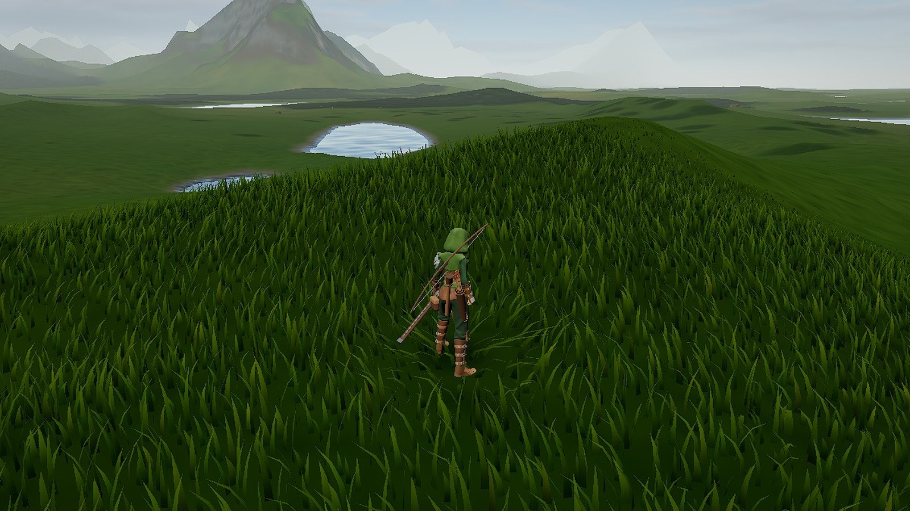
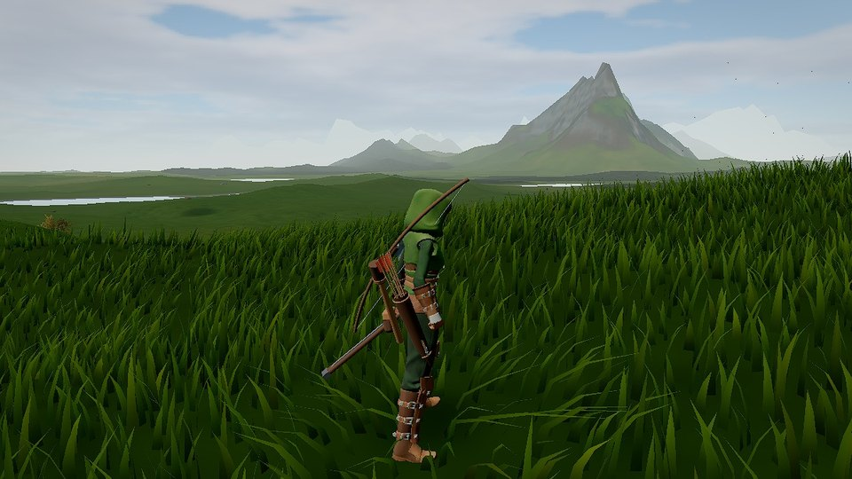
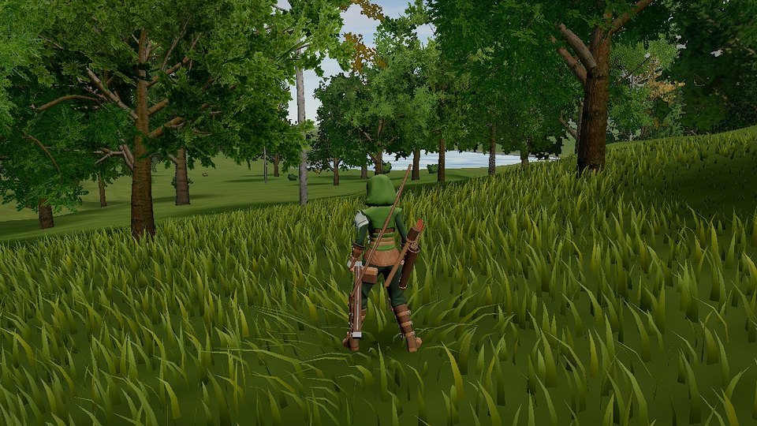
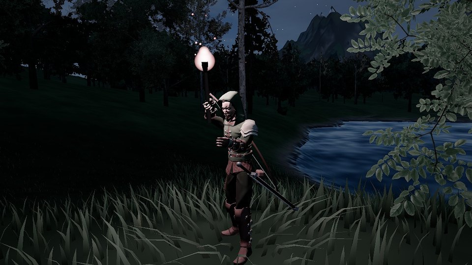
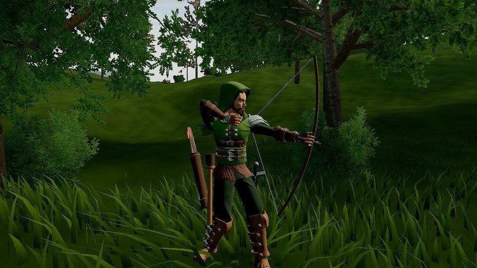
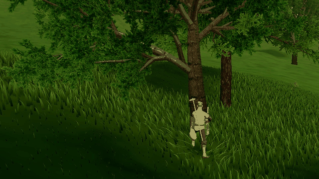

<p align="center">
  
</p>

<h1 align="center">Generate Infinite</h1>

<p align="center">
  <b>Pick a direction and walk. The land keeps coming.</b><br>
  An open world with no edge, made as you walk through it: hills, forests, lakes and mountain ranges under a sky that turns from dawn to starlight. A ranger with a longbow, a villager with an axe, and a world that remembers what you did to it. In your browser, nothing to install.
</p>

<p align="center">
  <a href="https://generate-infinite.vercel.app"></a>
</p>
<p align="center">
  
  
  
</p>

<p align="center">
  
</p>

## A world with no edge

There is no map to finish. The land is worked out as you come to it, so the hillside under your feet was never stored anywhere. Valleys open into lake basins, ridges climb into peaks, forests gather where the slope and soil suit them and thin out toward the tree line. Look back and the same land is still there: the same seed always grows the same world, and the game remembers where you stood and every tree you brought down. Add `?seed=` and any word to the address to visit another world.

<table>
  <tr>
    <td width="50%"></td>
    <td width="50%"></td>
  </tr>
  <tr>
    <td width="50%"></td>
    <td width="50%"></td>
  </tr>
</table>

## Two lives to live

<table>
  <tr>
    <td width="55%"></td>
    <td>
      <h3>The Ranger</h3>
      A sword at the hip, a longbow across the back, a torch at the belt. The bow is shot the way archers shot it: taken off the back over the shoulder, an arrow drawn from the quiver and nocked every time, the string pulled to the corner of the mouth, side-on to the mark. Arrows fly with gravity and drag and stay where they strike. He pulls his hood up and down with his own hands.
    </td>
  </tr>
  <tr>
    <td width="55%"></td>
    <td>
      <h3>The Villager</h3>
      An axe at the belt, a hoe across the back, a sickle in its sheath. Only the axe fells a tree: each chop bites a notch where it lands, and after five to twenty, by the trunk's thickness, the tree tips toward the cut, hinges on it and comes down, leaving a stump that stays there for good. The hoe turns the soil, the sickle mows the grass.
    </td>
  </tr>
</table>

## What you can do

- **Explore on foot.** Walk, jog and sprint with a runner's weight and lean; climb rock faces one hold at a time; swim and dive in the lakes; slide down slopes.
- **Carry real tools.** Everything is worn where people carried it and taken out step by step: the sword drawn from its scabbard, guards slipped off by the other hand, hands that close round what they hold.
- **Fight and hunt.** Sword strokes, combos and a dash strike from real animation; deer that graze, watch you come and bolt.
- **Watch the sky.** A physically based sky gives white noon light, orange sunsets, deep blue dusk and moonlit nights; clouds drift with the wind and storms roll in.
- **Listen.** Every sound is made as you play: wind and rain, birdsong by day, crickets at night, footsteps, splashes, the twang of the bow.

## Built for the browser

- **Three.js and TypeScript**, lit in linear HDR: ambient occlusion, bloom, filmic tone mapping, temporal anti-aliasing.
- **Cascaded sun shadows** reach kilometres out, so mountains shade the valleys at sunset.
- **Detail where you look:** dense grass that bends round your legs, photo-scanned rocks and ferns, trees with full, thinned and billboard versions that cross-fade, so nothing pops as you walk.
- **Fast on modest hardware:** quality is picked from your graphics card on the first visit, resolution can follow the frame time, ground textures are compressed on the GPU, the terrain is built in background threads, and the code is split so returning players keep the libraries cached.

The full list is in [docs/FEATURES.md](docs/FEATURES.md); where it goes next is in [docs/ENGINE-PLAN.md](docs/ENGINE-PLAN.md).

## Controls

| Action | Keys |
|---|---|
| Move · sprint · jump | WASD or arrows · Shift · Space |
| Crouch · slide (while sprinting) · dive (in deep water) | C |
| Climb | walk into a steep face, then W/A/S/D, Space to lunge, C to let go |
| Take out a tool (again to put it away) | 1 · 2 · 3 |
| Use it (hold for the bow) · heavy attack | E or click · Q |
| Hood up or down (Ranger) | G |
| Look | the mouse, after a click into the game (Esc frees it); or drag |
| Zoom · free camera | mouse wheel · V |
| Menu · keys · stats | Esc · H · B |

With a tool out you still run where you steer. Only drawing the bow keeps you facing your mark, with S stepping back and A/D stepping aside.

## Run it yourself

You need [Node.js](https://nodejs.org/).

```sh
npm install
npm run dev          # http://localhost:5173
npm run build        # the production build, in dist/
npm run type-check
```

Every push to `main` is deployed to [generate-infinite.vercel.app](https://generate-infinite.vercel.app). Changes are checked in the running game: [tools/probe](tools/probe/README.md) drives it in a headless browser and saves screenshots and measurements.

## Credits

Generate Infinite began as a TypeScript rework of [Infinite World](https://github.com/brunosimon/infinite-world) by **Bruno Simon**, and has grown far beyond it. Thank you, Bruno, for the original and for all you give the web community. How the TypeScript migration was done is described in [docs/FEATURES.md](docs/FEATURES.md#the-journey-to-typescript).

* Tree geometry generator from [EZ-Tree](https://github.com/dgreenheck/ez-tree) by Daniel Greenheck (MIT), vendored in `src/Game/Vendor/ezTree`. Ground and bark textures from Poly Haven and TextureCan (CC0), see `public/textures/CREDITS.md`.
* Rocks and ferns: photo scans from [Poly Haven](https://polyhaven.com) (CC0). `tools/nature/build.mjs` simplifies them (a quadric-error simplifier that keeps texture seams intact) and packs their textures into `public/models/nature` and `public/textures/nature`; `tools/terrain/build.sh` builds the ground textures.
* Post-processing by [postprocessing](https://github.com/pmndrs/postprocessing) (pmndrs, zlib) and [N8AO](https://github.com/N8python/n8ao) (CC0).
* Player characters and animations by **[Quaternius](https://quaternius.com)**, CC0 1.0: [Universal Base Characters](https://quaternius.itch.io/universal-base-characters), [Modular Character Outfits - Fantasy](https://quaternius.itch.io/modular-character-outfits-fantasy) and the [Universal Animation Library](https://quaternius.itch.io/universal-animation-library) and [Universal Animation Library 2](https://quaternius.itch.io/universal-animation-library-2) (free Standard versions). `tools/characters/build.mjs` rebuilds `public/models/characters` from them; `tools/characters/add-clips.mjs` adds the tool clips.
* Deer and stag by **[Quaternius](https://quaternius.com)**, CC0 1.0, from the [Ultimate Animated Animal Pack](https://quaternius.com/packs/ultimateanimatedanimals.html) (via [Poly Pizza](https://poly.pizza/m/T6Cs7tmMHJ)), in `public/models/animals`.
